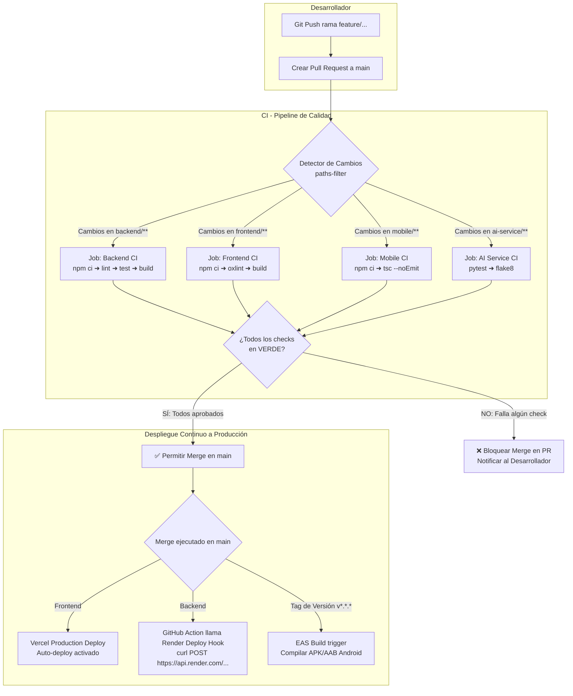

# Plan Hito 5 — Integración Continua y Despliegue Continuo (CI/CD) para AutoParts Pro

> **Versión:** 18/11/2026 → 27/11/2026 · **Proyecto:** AutoParts Pro / AutoRepuestos PRO (Inventario y Ventas para 7 importadoras).  
> **Hito previo:** Hito 4 cerrado (Modelo Predictivo de Demanda y Éxito de Autopartes con Random Forest + ONNX in-process).  
> **Propósito:** Implementar una infraestructura completa de **Integración Continua (CI)** y **Despliegue Continuo (CD)** sobre GitHub Actions, protegiendo la rama `main` contra roturas de compilación, linters y tests, y automatizando los despliegues a Render (Backend), Vercel (Frontend) y compilaciones en EAS (Móvil).

---

## 0. Auditoría de Modos de Falla del Flujo Actual (¿Por qué necesitamos CI/CD?)

Actualmente, el cumplimiento de la política de entrega (*"main solo recibe código que pasa build + lint"*) depende exclusivamente de la disciplina manual de cada desarrollador. Esto genera los siguientes **8 modos de falla críticos**:

| # | Modo de Falla Crítico | Causa Raíz en el Proyecto | Solución en este Plan |
| :--- | :--- | :--- | :--- |
| **1** | **Ruptura de despliegue en Render** | Un commit mergeado a `main` pasa inadvertido con un error de TypeScript en NestJS; Render falla en pleno build de producción. | **Job `backend-ci`** en GitHub Actions: bloquea el PR si `npm run build` falla. |
| **2** | **Desincronización de `package-lock.json`** | Un desarrollador instala una librería local pero no commitea el lockfile o hay discrepancias entre OS (Windows vs Linux). | Uso estricto de **`npm ci`** en los runners de GitHub Actions (falla de inmediato si el lockfile no coincide con `package.json`). |
| **3** | **Falso positivo de Jest con `onnxruntime-node`** | Si un test unitario intenta instanciar la sesión ONNX dentro de Jest, falla por el realm de `Float32Array` (trampa documentada en Hito 3). | El CI ejecuta `npm test` para tests unitarios estándar y un step separado para `npm run face:check`. |
| **4** | **Consumo explosivo de minutos en GitHub Actions** | Si cada commit en `docs/` o `frontend/` compila los 4 subproyectos, se agota la cuota gratuita de 2.000 min/mes. | **Filtros de ruta (`dorny/paths-filter`)**: cada job corre únicamente si cambiaron archivos dentro de su subdirectorio (`backend/**`, `frontend/**`, etc.). |
| **5** | **Fuga de secretos de entorno** | Subir variables sensibles (`JWT_SECRET`, credenciales de Supabase o Render) al repo o imprimirlas en los logs de CI. | Variables centralizadas en **GitHub Secrets** y comprobación estricta de que `.gitignore` cubre todos los `.env`. |
| **6** | **Roto el build de Expo en dispositivos** | Se commitea código móvil que compila en web pero tiene tipos rotos o módulos nativos no compatibles con SDK 57. | **Job `mobile-ci`** con `npx tsc --noEmit` obligatorio en el runner Linux de GitHub. |
| **7** | **Race condition en auto-deploy de Render** | Render detecta el push a `main` y despliega al mismo tiempo que GitHub corre las pruebas; si las pruebas fallan, el código roto ya está desplegado. | Desactivar *Auto-Deploy* automático en Render y dispararlo mediante **Deploy Hook** condicionado al éxito del CI. |
| **8** | **Regresiones de formato y reglas de código** | Discrepancia entre Oxlint en frontend y ESLint en backend que desordena el historial de Git. | Ejecución automatizada de `npm run lint` en los checks obligatorios de cada PR. |

---

## 1. Alcance, Decisiones y Arquitectura

### 1.1 Decisiones Técnicas

| Área | Decisión | Justificación |
| :--- | :--- | :--- |
| **Orquestador Principal** | **GitHub Actions** | Integración nativa con el repositorio, cuota gratuita suficiente (2.000 min/mes para repos públicos/privados), sin necesidad de mantener servidores Jenkins/GitLab. |
| **Matriz de Ejecución** | **Runners Ubuntu 22.04 (`ubuntu-latest`)** con Node.js 20 LTS | Entorno homogéneo que simula el entorno real de producción de Render y Vercel. |
| **Estrategia de Monorepo** | **Jobs independientes condicionados por path** | Repositorio multi-proyecto (`backend/`, `frontend/`, `mobile/`, `ai-service/`). Un cambio en web no debe disparar el pipeline de móvil ni de backend. |
| **Estrategia de CD Backend** | **Deploy Hook URL de Render** disparado vía cURL desde GitHub Actions | Garantiza que Render **solo** compile y levante el servicio cuando todos los tests y builds del CI hayan resultado en verde. |
| **Estrategia de CD Frontend** | **Integración Nativa GitHub ➜ Vercel** (con preview deployments por PR) | Genera automáticamente entornos efímeros de prueba para cada Pull Request y despliega a producción al mergear a `main`. |
| **Estrategia de CD Móvil** | **EAS Build (Expo Application Services)** | Compilación en la nube de Android (`.apk` de testing o `.aab` para producción) activada manualmente o por tag de release (`v*.*.*`). |
| **Política de Rama `main`** | **Branch Protection Rules (Status Checks obligatorios)** | Nadie puede hacer push directo a `main`. Todo merge exige PR aprobado y los checks de CI en estado verde. |

---

### 1.2 Diagrama del Flujo CI/CD



---

## 2. Definición Detallada de los Pipelines de GitHub Actions

### 2.1 Pipeline de Integración Continua (`.github/workflows/ci.yml`)

Este flujo se ejecuta en **todo Pull Request** apuntando a `main` y en cada `push` a `main`.

```yaml
name: CI Quality Gate

on:
  pull_request:
    branches: [main]
  push:
    branches: [main]

concurrency:
  group: ${{ github.workflow }}-${{ github.ref }}
  cancel-in-progress: true

jobs:
  # ─────────────────────────────────────────────────────────────
  # 1. DETECCIÓN DE CAMBIOS (Ahorro de minutos de runner)
  # ─────────────────────────────────────────────────────────────
  changes:
    name: Detectar Subproyectos Modificados
    runs-on: ubuntu-latest
    outputs:
      backend: ${{ steps.filter.outputs.backend }}
      frontend: ${{ steps.filter.outputs.frontend }}
      mobile: ${{ steps.filter.outputs.mobile }}
      ai_service: ${{ steps.filter.outputs.ai_service }}
    steps:
      - uses: actions/checkout@v4
      - uses: dorny/paths-filter@v3
        id: filter
        with:
          filters: |
            backend:
              - 'backend/**'
            frontend:
              - 'frontend/**'
            mobile:
              - 'mobile/**'
            ai_service:
              - 'ai-service/**'

  # ─────────────────────────────────────────────────────────────
  # 2. VALIDACIÓN BACKEND (NestJS + TypeORM + ONNX Runtime)
  # ─────────────────────────────────────────────────────────────
  backend-ci:
    name: Backend CI
    needs: changes
    if: ${{ needs.changes.outputs.backend == 'true' || github.event_name == 'push' }}
    runs-on: ubuntu-latest
    defaults:
      run:
        working-directory: backend
    steps:
      - uses: actions/checkout@v4

      - name: Instalar Node.js 20
        uses: actions/setup-node@v4
        with:
          node-version: 20
          cache: 'npm'
          cache-dependency-path: backend/package-lock.json

      - name: Instalar dependencias exactas
        run: npm ci

      - name: Ejecutar Linter (ESLint)
        run: npm run lint

      - name: Ejecutar Tests Unitarios (Jest)
        run: npm test

      - name: Compilar Proyecto (TypeScript build a dist/)
        run: npm run build

  # ─────────────────────────────────────────────────────────────
  # 3. VALIDACIÓN FRONTEND (React 19 + Vite 8 + TypeScript)
  # ─────────────────────────────────────────────────────────────
  frontend-ci:
    name: Frontend CI
    needs: changes
    if: ${{ needs.changes.outputs.frontend == 'true' || github.event_name == 'push' }}
    runs-on: ubuntu-latest
    defaults:
      run:
        working-directory: frontend
    steps:
      - uses: actions/checkout@v4

      - name: Instalar Node.js 20
        uses: actions/setup-node@v4
        with:
          node-version: 20
          cache: 'npm'
          cache-dependency-path: frontend/package-lock.json

      - name: Instalar dependencias exactas
        run: npm ci

      - name: Ejecutar Linter (Oxlint)
        run: npm run lint

      - name: Compilar y validar tipos (tsc -b && vite build)
        run: npm run build

  # ─────────────────────────────────────────────────────────────
  # 4. VALIDACIÓN MÓVIL (Expo 57 / React Native 0.86)
  # ─────────────────────────────────────────────────────────────
  mobile-ci:
    name: Mobile CI
    needs: changes
    if: ${{ needs.changes.outputs.mobile == 'true' || github.event_name == 'push' }}
    runs-on: ubuntu-latest
    defaults:
      run:
        working-directory: mobile
    steps:
      - uses: actions/checkout@v4

      - name: Instalar Node.js 20
        uses: actions/setup-node@v4
        with:
          node-version: 20
          cache: 'npm'
          cache-dependency-path: mobile/package-lock.json

      - name: Instalar dependencias exactas
        run: npm ci

      - name: Typecheck con TypeScript (sin emitir archivos)
        run: npx tsc --noEmit

  # ─────────────────────────────────────────────────────────────
  # 5. VALIDACIÓN AI SERVICE (FastAPI / YOLO11n-cls)
  # ─────────────────────────────────────────────────────────────
  ai-service-ci:
    name: AI Service CI
    needs: changes
    if: ${{ needs.changes.outputs.ai_service == 'true' }}
    runs-on: ubuntu-latest
    defaults:
      run:
        working-directory: ai-service
    steps:
      - uses: actions/checkout@v4

      - name: Configurar Python 3.10
        uses: actions/setup-python@v5
        with:
          python-version: '3.10'
          cache: 'pip'

      - name: Instalar dependencias
        run: |
          python -m pip install --upgrade pip
          if [ -f requirements.txt ]; then pip install -r requirements.txt; fi
          pip install flake8 pytest

      - name: Verificación estática con flake8
        run: |
          # Detiene la ejecución si hay errores de sintaxis
          flake8 . --count --select=E9,F63,F7,F82 --show-source --statistics
```

---

### 2.2 Pipeline de Despliegue Continuo a Render (`.github/workflows/cd-backend.yml`)

Este flujo se ejecuta **únicamente** cuando se hace merge a `main` y hubo cambios en `backend/`.

```yaml
name: CD Backend (Render Deploy)

on:
  push:
    branches: [main]
    paths:
      - 'backend/**'

jobs:
  deploy-render:
    name: Disparar Despliegue en Render
    runs-on: ubuntu-latest
    steps:
      - name: Invocar Deploy Hook de Render
        env:
          RENDER_DEPLOY_HOOK: ${{ secrets.RENDER_BACKEND_DEPLOY_HOOK }}
        run: |
          if [ -z "$RENDER_DEPLOY_HOOK" ]; then
            echo "Error: El secreto RENDER_BACKEND_DEPLOY_HOOK no está configurado."
            exit 1
          fi
          echo "Disparando despliegue en Render..."
          RESPONSE=$(curl -s -w "\nHTTP_STATUS:%{http_code}" -X POST "$RENDER_DEPLOY_HOOK")
          HTTP_STATUS=$(echo "$RESPONSE" | grep "HTTP_STATUS" | cut -d':' -f2)
          echo "Código HTTP recibido: $HTTP_STATUS"
          if [ "$HTTP_STATUS" -ne 200 ] && [ "$HTTP_STATUS" -ne 201 ]; then
            echo "Fallo al contactar el webhook de Render."
            exit 1
          fi
          echo "Despliegue ordenado exitosamente a Render."
```

---

## 3. Configuración de Seguridad y Secretos

### 3.1 Matriz de Secretos en GitHub Repository Settings

Los siguientes secretos deben configurarse en GitHub (**Settings ➜ Secrets and variables ➜ Actions**):

| Nombre del Secreto | Para qué se usa | Quién lo genera |
| :--- | :--- | :--- |
| `RENDER_BACKEND_DEPLOY_HOOK` | URL secreta del webhook de Render para ordenar el despliegue del backend. | Brian (Dashboard de Render ➜ Backend Service ➜ Settings ➜ Deploy Hook). |
| `EXPO_TOKEN` | Token de autenticación para que GitHub Actions pueda compilar con EAS CLI. | Raul (expo.dev ➜ Account Settings ➜ Access Tokens). |
| `VERCEL_TOKEN` *(Opcional)* | Solo necesario si el deploy de Vercel se orquesta vía CLI en vez de la integración directa. | Marco (vercel.com ➜ Account Settings ➜ Tokens). |

### 3.2 Protección de Ramas (Branch Protection Rules)

Para garantizar que ningún código roto entre a `main`:
1. Ir a **Settings ➜ Branches ➜ Add branch protection rule**.
2. **Branch name pattern:** `main`.
3. Marcar:
   * **Require a pull request before merging** (mínimo 1 aprobación).
   * **Require status checks to pass before merging**:
     * Seleccionar los checks generados: `Backend CI`, `Frontend CI`, `Mobile CI`.
   * **Require branches to be up to date before merging**.
   * **Do not allow bypassing the above settings** (aplica incluso para administradores).

---

## 4. Lista General de Tareas de Implementación

A continuación se detalla la secuencia de tareas técnicas generales para implementar y validar la infraestructura CI/CD en el proyecto, organizadas por fases lógicas de ejecución:

### Fase 1: Auditoría y Congelamiento de Dependencias Locales
* **Tarea 1.1 — Auditoría del Backend:** Probar en local la secuencia estricta `npm ci`, `npm run lint`, `npm test` y `npm run build` en `backend/`. Confirmar que los modelos `.onnx` no bloqueen la compilación y que los tests de Jest no ejecuten sesiones de inferencia reales.
* **Tarea 1.2 — Auditoría del Frontend:** Ejecutar `npm ci`, `npm run lint` (`oxlint`) y `npm run build` en `frontend/`. Limpiar cualquier advertencia crítica o error de tipado en Vite/React.
* **Tarea 1.3 — Auditoría de Mobile:** Ejecutar `npm ci` y `npx tsc --noEmit` en `mobile/`. Resolver discrepancias de tipos de Expo SDK 57 con paquetes de React Native.
* **Tarea 1.4 — Aseguramiento de Secretos y `.gitignore`:** Auditar con `git ls-files` que ningún archivo `.env`, `.env.local` o credencial privada esté versionada en el árbol de Git.

### Fase 2: Configuración del Pipeline de Integración Continua (CI)
* **Tarea 2.1 — Creación del Workflow Base:** Crear el archivo `.github/workflows/ci.yml` configurando los eventos `pull_request` y `push` a `main`, con cancelación de builds redundantes (`concurrency`).
* **Tarea 2.2 — Detección Inteligente de Subdirectorios:** Implementar la acción `dorny/paths-filter` para segmentar la ejecución y evitar que cambios aislados (ej. sólo documentación o sólo web) disparen pipelines de todo el monorepo.
* **Tarea 2.3 — Job de CI para Backend:** Configurar runner Node 20, caché de dependencias con `package-lock.json`, `npm ci`, `npm run lint`, `npm test` y compilación a `dist/`.
* **Tarea 2.4 — Job de CI para Frontend:** Configurar runner Node 20, caché de dependencias, `npm ci`, `npm run lint` y compilación con Vite.
* **Tarea 2.5 — Job de CI para Mobile:** Configurar runner Node 20, caché de dependencias, `npm ci` y validación estricta de TypeScript con `npx tsc --noEmit`.
* **Tarea 2.6 — Job de CI para AI Service:** Configurar runner Python 3.10 para `ai-service/`, instalación de `requirements.txt` y análisis estático con `flake8`.

### Fase 3: Pruebas de Calidad, Bloqueo y Validación de Filtros
* **Tarea 3.1 — Verificación de Filtros de Path:** Abrir un Pull Request modificando exclusivamente `mobile/` y verificar que los jobs de `backend-ci` y `frontend-ci` sean omitidos (*skipped*), ahorrando minutos de cómputo.
* **Tarea 3.2 — Prueba de Bloqueo por Error en Backend:** Introducir intencionalmente un error de sintaxis en NestJS dentro de una rama de prueba y comprobar que GitHub Actions detecta el error y marca el check en rojo en el PR.
* **Tarea 3.3 — Prueba de Bloqueo por Error en Frontend:** Introducir intencionalmente un error de tipado en React y verificar que el Pull Request queda bloqueado impidiendo el merge.

### Fase 4: Despliegue Continuo (CD) para Backend y Frontend
* **Tarea 4.1 — Configuración de Deploy Hook de Render:** Desactivar la opción *Auto-Deploy on Push* en el dashboard de Render. Generar la URL de *Deploy Hook* y registrarla como secreto `RENDER_BACKEND_DEPLOY_HOOK` en GitHub Repository Settings.
* **Tarea 4.2 — Workflow de CD para Backend:** Crear `.github/workflows/cd-backend.yml` para invocar mediante cURL el Deploy Hook de Render únicamente tras merges exitosos en `main`.
* **Tarea 4.3 — Healthcheck Activo Post-Despliegue:** Agregar un step con reintentos en el CD para consultar el endpoint `/api/attendance/face/status` y confirmar que el servicio en Render levantó sin errores.
* **Tarea 4.4 — Configuración de CD Frontend en Vercel:** Vincular el repositorio en Vercel con directorio raíz `frontend/`. Activar *Preview Deployments* para que cada Pull Request genere un entorno efímero de prueba funcional.

### Fase 5: Compilación Cloud para Móvil (Expo EAS)
* **Tarea 5.1 — Parametrización de `eas.json`:** Configurar los perfiles de compilación (`preview`, `production`) dentro de `mobile/eas.json`.
* **Tarea 5.2 — Secreto de Expo:** Generar un Access Token en `expo.dev` y registrarlo como `EXPO_TOKEN` en GitHub Secrets.
* **Tarea 5.3 — Workflow de CD Móvil:** Crear `.github/workflows/cd-mobile.yml` configurado para dispararse al pushear tags de versión (`v*.*.*`) y compilar el APK de Android en la nube de EAS de forma no interactiva.

### Fase 6: Gobernanza de Ramas, Simulación E2E y Documentación
* **Tarea 6.1 — Activación de Branch Protection Rules:** Configurar las reglas de protección para la rama `main` en GitHub: exigir Pull Request obligatorio, revisión humana y status checks en verde (`Backend CI`, `Frontend CI`, `Mobile CI`) para permitir el merge.
* **Tarea 6.2 — Simulacro End-to-End:** Realizar un flujo real completo: crear rama feature, abrir PR, validar paso de checks automáticos, aprobar, mergear a `main` y verificar el despliegue automático en vivo tanto en Vercel como en Render.
* **Tarea 6.3 — Actualización Documental:** Actualizar `docs/arquitectura.md` con el diagrama de infraestructura CI/CD y `docs/git-convention.md` con la guía de interpretación y resolución de checks de CI.

---

## 5. Bloqueos Técnicos Conocidos y Medidas Preventivas

| # | Bloqueo Potencial | Dónde Ocurre | Solución Preventiva |
| :--- | :--- | :--- | :--- |
| **1** | **`npm ci` falla por lockfile desactualizado** | GitHub Runner | Siempre ejecutar `npm install` localmente antes de hacer commit si se cambiaron dependencias en `package.json`. |
| **2** | **Falso error de Jest por Float32Array en `onnxruntime-node`** | Backend CI | Los tests unitarios en Jest deben mockear `FaceService` o `PredictionService`. La inferencia real se prueba con `npm run face:check`, no dentro del harness de Jest. |
| **3** | **Agotamiento de minutos de GitHub Actions** | Cuenta de GitHub | Uso indispensable de `paths-filter` para no ejecutar jobs redundantes, y flag `cancel-in-progress: true` para cancelar builds viejos si se sube un nuevo commit al mismo PR. |
| **4** | **Render Free entra en suspensión** | CD Backend | El health-check post-deploy debe contemplar un timeout de hasta 90 segundos por el arranque en frío (cold start) de Render Free. |
| **5** | **Fallo en Expo TypeScript check** | Mobile CI | En Linux, los nombres de archivos distinguen mayúsculas/minúsculas (*case-sensitive*). Si un archivo se llama `ScannerScreen.tsx` y se importa como `./scannerscreen`, Windows compila pero el CI de GitHub fallará. |

---

## 6. Definition of Done (Criterios de Aceptación del Hito 5)

1. **Pipeline de CI Operativo:** Todo Pull Request hacia `main` dispara automáticamente las validaciones de TypeScript, linters y tests de las carpetas involucradas.
2. **Rama `main` Protegida:** Es técnicamente imposible realizar un push directo a `main` o mergear un PR con checks en rojo.
3. **Optimización de Recursos:** Un cambio exclusivo en documentación o en frontend no consume tiempo de compilación del backend ni del móvil.
4. **Despliegue Continuo de Frontend:** Al hacer merge en `main`, Vercel actualiza la versión de producción sin intervención humana.
5. **Despliegue Continuo de Backend Seguro:** Render solo inicia el build de producción si los tests y la compilación previa en GitHub Actions concluyeron con éxito.
6. **Móvil Automatizado:** Existe un workflow capaz de generar el APK de prueba en la nube mediante EAS Build a partir de un tag de Git.
7. **Documentación:** El flujo de trabajo con CI/CD queda registrado en `docs/git-convention.md` y `docs/arquitectura.md`.
