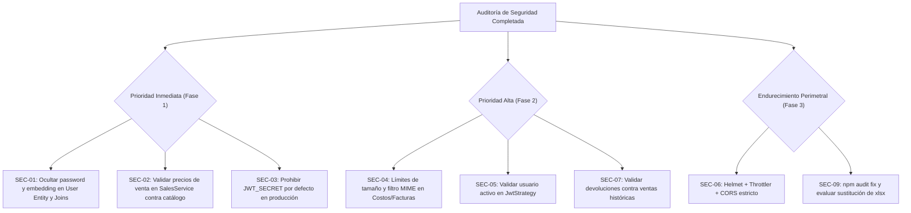

# Auditoría Integral de Seguridad — AutoParts Pro

> **Fecha de ejecución:** 22/11/2026 · **Rama de auditoría:** `feature/auditoria-seguridad`  
> **Alcance:** Backend (NestJS 11 + TypeORM), Frontend Web (React 19 + Vite), App Móvil (Expo 57), Base de Datos (PostgreSQL en Supabase) y Dependencias.  
> **Clasificación de riesgo:** Basado en estándar CVSS / OWASP Top 10 (2021) y OWASP API Security Top 10 (2023).

---

## 1. Resumen Ejecutivo

Se ha llevado a cabo una auditoría de seguridad integral sobre el repositorio **AutoParts Pro / InventarioAutopartesI**. El sistema cuenta con una arquitectura base sólida (RBAC estructurado con decoradores `@Roles`, uso sistemático de `Parameterized Queries` en TypeORM, buckets privados en Supabase con URLs firmadas para datos biométricos y uso de `SecureStore` en dispositivos móviles nativos).

No obstante, se han detectado **3 vulnerabilidades Críticas**, **2 Altas**, **3 Medias** y **1 Baja/Informativa** que comprometen la privacidad de datos biométricos/personales, la integridad financiera en ventas y la resiliencia del servicio ante ataques de denegación de servicio o falsificación de identidad.

### Matriz de Hallazgos

| ID | Severidad | Categoría OWASP | Descripción del Hallazgo | Estado |
| :--- | :--- | :--- | :--- | :--- |
| **SEC-01** | **CRÍTICA** | API3:2023 Broken Object Property Level Authorization | **Fuga de contraseñas (bcrypt) y biometría (ArcFace 512 floats)** en `leftJoinAndSelect` de Ventas, Movimientos, Devoluciones y Solicitudes. | Pendiente parche |
| **SEC-02** | **CRÍTICA** | API6:2023 Unrestricted Access to Sensitive Business Flows | **Manipulación de precios de venta:** el cliente envía `precio` arbitrario sin validación contra catálogo o margen mínimo. | Pendiente parche |
| **SEC-03** | **CRÍTICA** | API2:2023 Broken Authentication | **Clave secreta JWT con fallback público** (`'unifranz-inventario-secret'`) predecible en código fuente. | Pendiente parche |
| **SEC-04** | **ALTA** | API8:2023 Security Misconfiguration | **Subida de archivos sin validación de tipo ni límite de tamaño** en módulo de Costos (`/facturas`). Riesgo de DoS y ejecución/XSS. | Pendiente parche |
| **SEC-05** | **ALTA** | API2:2023 Broken Authentication | **Sesiones JWT no revocables:** `JwtStrategy` no valida si el usuario fue dado de baja (`activo: false`) en la base de datos. | Pendiente parche |
| **SEC-06** | **MEDIA** | API8:2023 Security Misconfiguration | **CORS permisivo (`origin: *`)** y ausencia de cabeceras HTTP de seguridad (`helmet`) y limitador de tasa (`throttler`). | Pendiente parche |
| **SEC-07** | **MEDIA** | API6:2023 Unrestricted Access to Sensitive Business Flows | **Devoluciones sin validación de ventas previas** y sin control de devoluciones duplicadas sobre el mismo ítem. | Pendiente parche |
| **SEC-08** | **MEDIA** | A03:2021 Injection / XSS | **Almacenamiento de tokens de autenticación en `localStorage`** en el cliente web. | Pendiente parche |
| **SEC-09** | **MEDIA** | A06:2021 Vulnerable and Outdated Components | **Vulnerabilidades en dependencias:** `xlsx` (Prototype Pollution / ReDoS) y `proxy-addr` (IP spoofing). | Pendiente parche |

---

## 2. Detalle de Vulnerabilidades y Evidencia Técnica

### SEC-01. Fuga de Hashes de Contraseña y Vectores Biométricos en Joins (CRÍTICA)

* **Vulnerabilidad:** Fuga de datos sensibles (PII / Datos Biométricos bajo Ley 26935).
* **Archivos afectados:**
  - `backend/src/entities/user.entity.ts`
  - `backend/src/sales/sales.service.ts` (líneas 246 y 288)
  - `backend/src/movimientos/movimientos.service.ts` (línea 32)
  - `backend/src/devoluciones/devoluciones.service.ts` (línea 41)
  - `backend/src/solicitudes/solicitudes.service.ts` (línea 34)

#### Evidencia del Código
En `user.entity.ts`, las propiedades `password` y `embedding` no cuentan con la opción `{ select: false }`:
```typescript
@Column()
password: string;

@Column({ type: 'jsonb', nullable: true })
embedding: number[] | null;
```
Cuando servicios como `sales.service.ts` realizan:
```typescript
qb.leftJoinAndSelect('s.usuario', 'usuario')
```
TypeORM recupera **todas** las columnas de la tabla `users`. El endpoint `GET /api/sales` y `GET /api/sales/:id` retorna directamente la entidad completa, exponiendo:
1. El hash `bcrypt` de la contraseña del vendedor.
2. El vector biométrico de 512 valores de punto flotante de su rostro.

#### Remediación Propuesta
1. Declarar `{ select: false }` tanto en `password` como en `embedding` en `User.entity.ts`:
   ```typescript
   @Column({ select: false })
   password: string;

   @Column({ type: 'jsonb', nullable: true, select: false })
   embedding: number[] | null;
   ```
2. En las consultas con `leftJoin`, seleccionar explícitamente solo las columnas públicas del operador (`id`, `nombre`, `apellido`, `email`, `rol`).

---

### SEC-02. Manipulación Arbitraria de Precios de Venta (CRÍTICA)

* **Vulnerabilidad:** Fraude financiero / Ausencia de guardrails de precios en transacciones comerciales.
* **Archivo afectado:** `backend/src/sales/sales.service.ts` (líneas 122–154)

#### Evidencia del Código
Al registrar una venta (`POST /api/sales`):
```typescript
if (!Number.isFinite(it.precio) || it.precio < 0) {
  throw new BadRequestException('El precio no puede ser negativo');
}
...
const subtotal = it.cantidad * it.precio;
total += subtotal;
```
El backend toma ciegamente `it.precio` enviado por el cliente. Si un usuario o atacante envía:
```json
{
  "items": [{ "productId": 10, "cantidad": 5, "precio": 0.50 }],
  "pagos": [{ "metodo": "Efectivo", "monto": 2.50 }]
}
```
El sistema descuenta el stock de 5 unidades de un repuesto de Bs. 400 aceptando un cobro total de Bs. 2.50, porque `totalPagos === total`.

#### Remediación Propuesta
1. El backend debe consultar el precio oficial del producto (`product.precio1` o `product.precio2` si es mayorista).
2. Si se admite un descuento o precio especial, debe aplicarse un límite máximo porcentual (ej. no menor a `product.costo * 1.15` o requerir autorización de rol `admin`).

---

### SEC-03. Clave Secreta JWT con Fallback Inseguro en Código (CRÍTICA)

* **Vulnerabilidad:** Forjado de Tokens JWT con privilegios de Administrador.
* **Archivos afectados:**
  - `backend/src/auth/auth.module.ts` (línea 15)
  - `backend/src/auth/jwt.strategy.ts` (línea 18)

#### Evidencia del Código
```typescript
secret: process.env.JWT_SECRET || 'unifranz-inventario-secret',
```
Si la variable `JWT_SECRET` no está configurada o se omite en el archivo de entorno de producción, el sistema firma y valida tokens usando `'unifranz-inventario-secret'`. Un atacante puede crear un token con payload `{ "sub": 1, "rol": "admin" }` y obtener acceso administrativo total.

#### Remediación Propuesta
1. Exigir obligatoriamente `JWT_SECRET` en producción; lanzar un error fatal en el arranque si no está definida o si coincide con la clave por defecto.
2. Generar una clave criptográfica de al menos 256 bits (32 bytes aleatorios en base64) exclusiva para el entorno de producción.

---

### SEC-04. Subida de Archivos Sin Validación en Módulo de Costos (ALTA)

* **Vulnerabilidad:** Denegación de servicio (DoS) / Subida de archivos no restringida.
* **Archivos afectados:**
  - `backend/src/costos/costos.controller.ts` (línea 47)
  - `backend/src/costos/costos.service.ts` (líneas 100–108)

#### Evidencia del Código
```typescript
@UseInterceptors(FileInterceptor('archivo')) // <-- Sin límites ni filtro MIME
...
const ext = path.extname(file.originalname) || '.pdf';
const filename = `factura-${Date.now()}-${Math.round(Math.random() * 1000)}${ext}`;
fs.writeFileSync(path.join(UPLOADS_DIR, filename), file.buffer);
```
No hay validación del tipo MIME real ni límite de tamaño (`limits.fileSize`). Un usuario con rol `admin` puede subir archivos de gigabytes agotando el espacio en disco, o archivos con extensiones peligrosas.

#### Remediación Propuesta
1. Configurar `FileInterceptor` con `multer` restringido a PDF y formatos de imagen (`application/pdf`, `image/jpeg`, `image/png`).
2. Limitar el tamaño máximo a 5 MB o 10 MB.
3. Almacenar las facturas en un bucket privado de Supabase en lugar de guardarlas localmente en el servidor.

---

### SEC-05. Falta de Revocación de Sesiones JWT en Baja Lógica (ALTA)

* **Vulnerabilidad:** Persistencia de credenciales tras baja o cambio de privilegios.
* **Archivo afectado:** `backend/src/auth/jwt.strategy.ts` (líneas 22–29)

#### Evidencia del Código
```typescript
validate(payload: JwtPayload) {
  return {
    id: payload.sub,
    email: payload.email,
    rol: payload.rol,
    tiendaId: payload.tiendaId,
  };
}
```
`JwtStrategy` no verifica el estado actual del usuario en la base de datos. Si un administrador desactiva a un empleado (`activo = false`) mediante `PATCH /api/users/:id`, el token JWT del empleado sigue siendo válido hasta que expiren las 8 horas configuradas.

#### Remediación Propuesta
Consultar en `validate()` el flag `user.activo`:
```typescript
const user = await this.usersService.findById(payload.sub);
if (!user || !user.activo) {
  throw new UnauthorizedException('Sesión inválida o usuario dado de baja');
}
```

---

### SEC-06. Ausencia de Helmet, Throttler y CORS Restrictivo (MEDIA)

* **Vulnerabilidad:** Ausencia de defensas perimetrales y cabeceras de endurecimiento HTTP.
* **Archivo afectado:** `backend/src/main.ts` (línea 9)

#### Evidencia del Código
```typescript
app.enableCors(); // <-- Permite cualquier origen sin restricción
```
No se incluye `helmet` (para cabeceras `X-Frame-Options`, `Content-Security-Policy`, `X-Content-Type-Options: nosniff`) ni `@nestjs/throttler` para mitigar ataques de fuerza bruta al endpoint `POST /api/auth/login`.

#### Remediación Propuesta
1. Configurar CORS con lista blanca (`origin: [process.env.FRONTEND_URL, ...]`).
2. Instalar e invocar `app.use(helmet())`.
3. Implementar `ThrottlerModule` con regla de 10 peticiones/minuto en `POST /auth/login`.

---

### SEC-07. Devoluciones Sin Trazabilidad de Venta ni Control de Duplicidad (MEDIA)

* **Vulnerabilidad:** Riesgo de fuga de inventario y efectivo en caja.
* **Archivo afectado:** `backend/src/devoluciones/devoluciones.service.ts` (líneas 128–153)

#### Evidencia del Código
`ventaId` es opcional. Un operador puede registrar devoluciones sin asociarlas a una venta real. Si se provee `saleItemId`, valida `cantidad <= saleItem.cantidad`, pero no descuenta las cantidades ya devueltas en transacciones anteriores sobre el mismo ítem.

#### Remediación Propuesta
1. Exigir obligatoriamente `ventaId` y `saleItemId` para cualquier devolución con reembolso monetario.
2. Calcular la suma histórica devuelta: `SUM(cantidadDevueltaPrevia) + nuevaCantidad <= saleItem.cantidad`.

---

### SEC-08. Almacenamiento de Tokens en `localStorage` (MEDIA)

* **Vulnerabilidad:** Exposición de tokens ante ataques de Cross-Site Scripting (XSS).
* **Archivo afectado:** `frontend/src/context/AuthContext.tsx` (línea 37)

#### Evidencia del Código
```typescript
localStorage.setItem('auth_token', response.token);
```
Aunque el equipo mitiga esto borrando el token al recargar la página (`useEffect` en montaje), durante la sesión el token reside en `localStorage`, accesible por cualquier script inyectado en el contexto del DOM.

#### Remediación Propuesta
Migrar a cookies `HttpOnly` y `SameSite=Strict` para el transporte del token JWT entre cliente y servidor.

---

### SEC-09. Vulnerabilidades en Dependencias de Terceros (MEDIA)

* **Vulnerabilidad:** CVEs en paquetes NPM.
* **Dependencias identificadas por `npm audit`:**
  - `xlsx` (todas las versiones): Vulnerable a *Prototype Pollution* (GHSA-4r6h-8v6p-xvw6) y *ReDoS* (GHSA-5pgg-2g8v-p4x9). No existe parche oficial en la versión libre.
  - `proxy-addr` (< 2.0.8): Vulnerable a *IP Spoofing* vía IPv4-mapped IPv6 subnets.
  - `undici` / `body-parser`: Vulnerables a Denegación de Servicio (solucionables con `npm audit fix`).

#### Remediación Propuesta
1. Ejecutar `npm audit fix` en `backend/` para actualizar dependencias transitivas seguras.
2. Evaluar la migración de `xlsx` a `exceljs` para la lectura y exportación de archivos Excel sin contaminación de prototipos.

---

## 3. Aspectos Positivos y Buenas Prácticas Encontradas

Durante la auditoría también se confirmaron defensas de seguridad correctamente implementadas:

1. **RBAC Integral a Nivel de Controlador:**  
   Todos los controladores del sistema (`Attendance`, `Products`, `Sales`, `Costos`, `Users`, etc.) tienen decoradores `@UseGuards(JwtAuthGuard, RolesGuard)` a nivel de clase. Ninguna ruta operativa queda expuesta sin autenticación.
2. **Consultas SQL Parametrizadas:**  
   No se encontraron concatenaciones directas de cadenas en cláusulas SQL (`where`, `andWhere`); todas las búsquedas dinámicas utilizan parámetros vinculados (`:prod`, `:s`, `:id`).
3. **Protección de Datos Biométricos en el Almacenamiento:**  
   Las fotografías faciales se almacenan en un bucket privado de Supabase (`faces`) y se sirven únicamente mediante URLs firmadas con tiempo de expiración corto (`urlFirmadaRostro`). Nunca se publican de forma abierta.
4. **Almacenamiento Seguro en Móvil:**  
   La app Expo utiliza `expo-secure-store` en dispositivos físicos (respaldado por KeyStore en Android y Keychain en iOS).
5. **Control de Puerta de Administrador en Kiosco (Tiqueador):**  
   El componente `AdminPasswordGate` valida la contraseña del administrador contra `POST /auth/login` y **descarta intencionalmente el nuevo token**, previniendo la corrupción de la sesión persistente del kiosco.
6. **Aislamiento Multisede de Tiendas:**  
   Los operadores con rol `tienda` tienen restringida la creación de ventas a su propia sede (`user.tiendaId === locationId`).

---

## 4. Plan de Acción y Prioridades de Corrección



---
*Documento elaborado como parte del ciclo de calidad y seguridad de AutoParts Pro.*

---

## Revisión independiente AUD-REV-03-20261122

> **Fecha:** 22/11/2026  
> **Tipo:** Revisión independiente, documental y estática  
> **Relación con la auditoría anterior:** esta sección **amplía y corrige** la auditoría precedente sin borrarla, sustituirla ni alterar su valor como registro histórico. Los dictámenes siguientes reflejan el código, la documentación y el índice de Git observados durante esta revisión.  
> **Estado común de los hallazgos:** **Pendiente**. Una corrección solo debe cerrarse después de pruebas, revisión de seguridad y actualización documental en el mismo commit.

### A. Hallazgos de seguridad consolidados

| ID | Dictamen | Severidad / prioridad | Evidencia | Retroalimentación y corrección requerida | Estado |
| :--- | :--- | :--- | :--- | :--- | :--- |
| **AUD3-SEG-001** | **El conteo del resumen no coincide con la matriz original.** La matriz contiene 3 críticas, 2 altas, 4 medias y 0 bajas/informativas, no 3 medias y 1 baja. | Media · P1 documental | `docs/auditoria-seguridad.md:13`; `docs/auditoria-seguridad.md:19-27` | Corregir el resumen manteniendo constancia de la cifra original. No reclasificar un hallazgo solo para hacer coincidir el total. | Pendiente |
| **AUD3-SEG-002** | **CVSS no fue aplicado realmente.** Se menciona “CVSS / OWASP”, pero no existen versión, vector, puntuación ni supuestos por hallazgo. OWASP es una taxonomía, no una escala de severidad. | Alta · P1 | `docs/auditoria-seguridad.md:5`; `docs/auditoria-seguridad.md:17-27` | Añadir por hallazgo CVSS v3.1 o v4.0, vector, score y alcance; si no se calcula, declarar “priorización cualitativa con mapeo OWASP orientativo”. | Pendiente |
| **AUD3-SEG-003** | **SEC-01 confirmado y ampliado.** `password`, `embedding` y la ruta privada `facePhoto` se seleccionan por defecto y los joins de ventas, movimientos, devoluciones y solicitudes serializan la entidad `User`. La ruta del objeto facial no equivale a una URL pública, pero continúa siendo metadato biométrico innecesario. | Crítica · P0 | `backend/src/entities/user.entity.ts:22-23`; `backend/src/entities/user.entity.ts:39-45`; `backend/src/sales/sales.service.ts:243-250`; `backend/src/sales/sales.service.ts:284-296`; `backend/src/movimientos/movimientos.service.ts:26-34`; `backend/src/devoluciones/devoluciones.service.ts:36-44`; `backend/src/solicitudes/solicitudes.service.ts:28-39` | Aplicar `select: false` a secretos/biometría y reemplazar cada join de usuario por columnas explícitas o DTO de salida. Añadir pruebas de regresión que comprueben ausencia de `password`, `embedding` y `facePhoto`. Corregir las afirmaciones contrarias en API/arquitectura. | Pendiente |
| **AUD3-SEG-004** | **SEC-02 confirmado y ampliado a creación, edición, importación y clientes web/móvil.** El backend acepta precios no negativos enviados por el cliente; `update` repite la misma regla y el Excel permite `Precio Mayor` arbitrario, incluso cero. La UI no constituye control de seguridad. | Crítica · P0 | `backend/src/sales/sales.service.ts:109-153`; `backend/src/sales/sales.service.ts:355-400`; `backend/src/sales/sales.service.ts:620-645`; `frontend/src/pages/ventas/SalesPage.tsx:290`; `mobile/src/screens/VentaMayorScreen.tsx:237` | Resolver precio y descuentos en servidor desde catálogo/reglas autorizadas; registrar precio base, descuento, autorizador y motivo. Aplicar el mismo contrato a create/update/import. Probar manipulación directa de API, no solo UI. | Pendiente |
| **AUD3-SEG-005** | **SEC-03 confirmado.** El fallback JWT público permite firmar tokens si falta `JWT_SECRET`. | Crítica · P0 | `backend/src/auth/auth.module.ts:15`; `backend/src/auth/jwt.strategy.ts:14-19` | Validar configuración al arranque y fallar de forma segura si falta el secreto o es débil/conocido. Rotar claves si el fallback fue usado en algún entorno y documentar estrategia de rotación. | Pendiente |
| **AUD3-SEG-006** | **SEC-04 es correcto solo parcialmente y está mal categorizado.** Costos y los dos endpoints Excel usan `FileInterceptor` sin límites/filtro; otras imágenes sí tienen 10 MiB, aunque varias confían únicamente en MIME declarado. El mapeo principal es OWASP API4:2023 Unrestricted Resource Consumption. | Alta · P0 | `backend/src/costos/costos.controller.ts:45-50`; `backend/src/sales/sales.controller.ts:80-93`; `backend/src/common/image-upload.ts:12-19`; `backend/src/attendance/attendance.controller.ts:69-78`; `backend/src/part-recognition/part-recognition.controller.ts:30-33` | Imponer bytes, archivos, campos, partes, extensión y contenido real a facturas/Excel; limitar filas, hojas, celdas y tiempo de parseo. Mantener API8 como categoría secundaria solo si se justifica configuración insegura. | Pendiente |
| **AUD3-SEG-007** | **SEC-05 confirmado.** La estrategia confía en claims emitidos y no revalida `activo`, rol, tienda ni versión de sesión; una baja o cambio de privilegio no revoca el JWT vigente. | Alta · P0 | `backend/src/auth/jwt.strategy.ts:22-29`; `backend/src/auth/auth.service.ts:32-38`; `ai-service/README.md:121` | Revalidar estado/rol/tienda o implementar `tokenVersion`/revocación. Definir efecto de cambio de contraseña, baja y cambio de rol. Añadir pruebas con token emitido antes del cambio. | Pendiente |
| **AUD3-SEG-008** | **SEC-06 confirmado.** CORS se habilita sin allowlist y no se observan Helmet ni rate limiting global/específico para login. | Media · P1 | `backend/src/main.ts:6-16`; `backend/package.json:32-55` | Configurar orígenes por entorno, Helmet y límites por IP/cuenta/ruta. Considerar proxy de Render al determinar IP y evitar bloqueos globales que afecten al kiosco. | Pendiente |
| **AUD3-SEG-009** | **SEC-07 debe elevarse a Alta.** La venta y el ítem son opcionales, no se acumulan devoluciones previas, el monto/método vienen del cliente y el guardado de devolución y reposición de stock no es atómico. | Alta · P0 | `backend/src/devoluciones/devoluciones.service.ts:88-124`; `backend/src/devoluciones/devoluciones.service.ts:126-173`; `backend/src/entities/devolucion.entity.ts:28-48` | Exigir trazabilidad para reembolso, validar suma histórica, monto máximo y método contra la venta/pagos; usar transacción y bloqueo. Definir excepción administrativa auditada para devoluciones sin comprobante. | Pendiente |
| **AUD3-SEG-010** | **SEC-08 describe exposición, pero está mal categorizado como A03/XSS.** `localStorage` no crea una XSS; amplifica su impacto. Migrar a cookie entre Vercel y Render exige resolver contexto cross-site, CORS con credenciales y CSRF: `SameSite=Strict` no funcionará sin dominio/proxy same-site. | Media · P1 | `frontend/src/context/AuthContext.tsx:19-22`; `frontend/src/context/AuthContext.tsx:31-39`; `frontend/src/api/client.ts:26-36`; `mobile/src/storage/token.ts:4-11` | Clasificar como manejo de sesión/autenticación. Preferir BFF/proxy same-site o cookie `HttpOnly; Secure` con política `SameSite` explícita y defensa CSRF. Mantener SecureStore nativo; documentar que Expo Web usa `localStorage`. | Pendiente |
| **AUD3-SEG-011** | **SEC-09 estaba incompleto.** Con `npm audit --omit=dev` se observaron: backend **1 crítica, 6 altas, 1 moderada**; frontend **0**; mobile **1 crítica, 12 altas, 9 moderadas**. Los totales deben distinguir dependencias de runtime de tooling y comprobar alcanzabilidad. | Crítica · P0 triage | `backend/package-lock.json`; `frontend/package-lock.json`; `mobile/package-lock.json`; `backend/package.json:32-55`; `mobile/package.json:5-33` | Conservar salida JSON, fecha, versión npm y lockfile; hacer triage por ruta explotable. Priorizar runtime (`xlsx`, `multer` y transitivas efectivamente empaquetadas); actualizar con pruebas y no aplicar `audit fix --force` sin revisar cambios mayores. | Pendiente |
| **AUD3-SEG-012** | **El tiqueador salta ArcFace por diseño actual.** La app siempre envía `usuarioId` tras seleccionar/buscar carnet; el backend registra manualmente y no analiza la foto cuando recibe ese campo. Por tanto, la cámara no prueba identidad en ese flujo. | Crítica · P0 | `mobile/src/screens/AttendanceScreen.tsx:273-310`; `backend/src/attendance/attendance.controller.ts:62-68`; `backend/src/attendance/attendance.service.ts:536-567`; `backend/src/attendance/attendance.service.ts:662-696` | Separar explícitamente “marcaje biométrico” y “marcaje manual autorizado”. El kiosco normal no debe enviar `usuarioId`; cualquier bypass manual debe exigir autorización reforzada, motivo y auditoría visible. | Pendiente |
| **AUD3-SEG-013** | **Los carnets son locales, sembrados y reasignables.** Se aceptan IDs directos y prefijos de email; cualquier valor puede asociarse localmente a un usuario sin validación central, unicidad ni prueba del documento. | Crítica · P0 | `mobile/src/storage/carnets.ts:5-26`; `mobile/src/storage/carnets.ts:28-68`; `mobile/src/storage/carnets.ts:71-100`; `mobile/src/screens/AttendanceScreen.tsx:235-255` | No tratar este mapa como identidad. Si el carnet pertenece al alcance, modelarlo en backend con unicidad, permisos administrativos, auditoría y verificación; eliminar semillas/lookup por ID/email del flujo productivo. | Pendiente |
| **AUD3-SEG-014** | **Faltan transacciones y bloqueo de concurrencia en operaciones críticas.** Create/update/import de ventas, movimientos, despacho de solicitudes, devoluciones y el read-modify-write de stock pueden dejar estados parciales o vender stock concurrentemente. | Crítica · P0 | `backend/src/sales/sales.service.ts:192-203`; `backend/src/sales/sales.service.ts:409-478`; `backend/src/sales/sales.service.ts:720-772`; `backend/src/movimientos/movimientos.service.ts:65-94`; `backend/src/solicitudes/solicitudes.service.ts:108-147`; `backend/src/devoluciones/devoluciones.service.ts:155-173`; `backend/src/products/products.service.ts:542-579` | Ejecutar cada operación completa en una transacción con el mismo `EntityManager`; usar actualización atómica o bloqueo pesimista/optimista sobre inventario. Definir idempotencia y pruebas de fallo intermedio/concurrencia. | Pendiente |
| **AUD3-SEG-015** | **BOLA/IDOR y filtros multisede incompletos en ventas.** El listado filtra tienda, pero `GET /sales/:id` no recibe al actor y `update` carga por ID antes de validar únicamente la ubicación destino. | Alta · P0 | `backend/src/sales/sales.controller.ts:31-55`; `backend/src/sales/sales.service.ts:258-281`; `backend/src/sales/sales.service.ts:284-300`; `backend/src/sales/sales.service.ts:320-327` | Autorizar cada objeto por sede/rol en servicio, incluidos detalle, nota y edición. No confiar en `locationId` del body para decidir si el actor puede tocar la venta original. Revisar devoluciones y reportes con la misma matriz. | Pendiente |
| **AUD3-SEG-016** | **Existe superficie de XSS en notas/impresión.** El HTML de nota interpola campos de cliente/venta y varias páginas escriben HTML en una ventana con `document.write`; no se evidencia escape/sanitización contextual. | Alta · P0 | `backend/src/sales/sales.service.ts:520`; `frontend/src/pages/ventas/HistorialVentasPage.tsx:91-93`; `frontend/src/pages/ventas/VentaMayorPage.tsx:337-339`; `frontend/src/pages/ventas/SalesPage.tsx:328-330`; `frontend/src/pages/reportes/ReportesPage.tsx:105-107` | Escapar toda entrada en servidor, generar documentos con plantillas seguras y evitar `document.write`. Añadir CSP/Helmet y pruebas con payloads HTML en nombre, CI/NIT, observaciones y campos de venta. | Pendiente |
| **AUD3-SEG-017** | **Hay secretos versionados.** `mobile/credentials.json` contiene credenciales de keystore y `usuario_cliente_modelo.txt` contiene credenciales de cuenta. No se reproducen sus valores en esta revisión. | Crítica · P0 | `mobile/credentials.json:1-10`; `usuario_cliente_modelo.txt:1-5`; `docs/entornos.md:3-6`; `docs/git-convention.md:93` | Rotar/revocar antes de retirar archivos; eliminar del índice y evaluar purga coordinada del historial. Invalidar la cuenta de prueba y revisar accesos. Agregar controles de secret scanning/pre-commit/CI. | Pendiente |
| **AUD3-SEG-018** | **No existe prueba de vida facial ni protección anti-replay.** El endpoint recibe una imagen estática, detecta/alinea el rostro y compara el embedding, pero no exige desafío temporal, secuencia, parpadeo, profundidad ni otra señal que permita distinguir a una persona presente de una fotografía o pantalla. | Alta · P0 | `backend/src/attendance/attendance.controller.ts:69-100`; `backend/src/attendance/attendance.service.ts:567-613`; `mobile/src/components/FaceCamera.tsx:125-147` | Incorporar una estrategia de liveness proporcional al riesgo y pruebas contra fotografía impresa, pantalla y video. Hasta entonces, no presentar el rostro como factor fuerte de autenticación presencial. | Pendiente |
| **AUD3-SEG-019** | **Uploads y Excel requieren endurecimiento adicional.** Las facturas se escriben síncronamente al filesystem y los Excel se reciben en memoria sin límites declarados. | Alta · P0 | `backend/src/costos/costos.service.ts:18`; `backend/src/costos/costos.service.ts:100-107`; `backend/src/costos/costos.controller.ts:45-50`; `backend/src/sales/sales.controller.ts:80-93` | Usar almacenamiento privado, nombres no controlados, análisis real de formato y límites de recursos. Evitar `writeFileSync` en request y aplicar política de retención/eliminación. | Pendiente |
| **AUD3-SEG-020** | **`DB_SYNC` cae a `true` por defecto.** Un entorno mal configurado puede alterar esquema al arrancar. | Alta · P0 | `backend/src/app.module.ts:48-50`; `docs/entornos.md:41-47` | Default seguro `false`; habilitar sincronización solo mediante configuración local explícita. En producción usar migraciones versionadas y validación de entorno al arranque. | Pendiente |
| **AUD3-SEG-021** | **TLS de base de datos desactiva validación de certificado.** `rejectUnauthorized: false` cifra, pero no autentica correctamente al servidor. | Alta · P1 | `backend/src/app.module.ts:30-46`; `docs/entornos.md:45-47` | Configurar CA verificable y `rejectUnauthorized: true` donde el proveedor lo permita. Documentar excepción temporal, amenaza MITM y entorno concreto si debe conservarse. | Pendiente |
| **AUD3-SEG-022** | **Los DTOs y la validación de entrada son débiles.** Varios controllers reciben `any` o interfaces TypeScript sin validación runtime; `forbidNonWhitelisted` está deshabilitado. | Alta · P1 | `backend/src/main.ts:10-15`; `backend/src/users/users.controller.ts:80-87`; `backend/src/products/products.controller.ts:104-111`; `backend/src/movimientos/movimientos.controller.ts:21-22`; `backend/src/solicitudes/solicitudes.controller.ts:29-30`; `backend/src/devoluciones/devoluciones.controller.ts:26-27`; `backend/src/sales/sales.service.ts:42-50` | Crear DTOs con `class-validator`, límites de longitud/rango/enums y rechazo de propiedades desconocidas. No usar tipos compile-time como frontera de confianza. | Pendiente |
| **AUD3-SEG-023** | **La supresión biométrica no es completa ni verificable.** La acción explícita `eliminarEmbedding` borra embedding y foto actual, pero `remove(id)` elimina al usuario sin borrar el objeto facial del bucket. Además, permanecen asistencias, confianza, método, confirmante y posibles respaldos sin política documentada de retención. | Alta · P0 privacidad | `backend/src/users/users.service.ts:112-132`; `backend/src/entities/asistencia.entity.ts`; `docs/api.md:66`; `docs/arquitectura.md:245-248` | Borrar o retener legalmente la foto mediante una política explícita también al eliminar usuarios; definir base legal, retención, respaldos y anonimización histórica. Entregar evidencia auditable de supresión y distinguir baja laboral de borrado biométrico. | Pendiente |
| **AUD3-SEG-024** | **El kiosco conserva un token administrativo completo.** El bloqueo es de UI; la tablet mantiene una credencial con privilegios amplios y solo vuelve a pedir la contraseña para entrar/salir del modo. | Crítica · P0 | `mobile/src/components/AdminPasswordGate.tsx:40-52`; `mobile/src/components/AdminPasswordGate.tsx:78-103`; `AGENTS.md:103` | Emitir una sesión/rol de terminal con alcance mínimo, sede fija, expiración/rotación y revocación independiente. No usar una cuenta admin compartida como credencial de operación diaria. | Pendiente |
| **AUD3-SEG-025** | **Varias cargas de imagen confían en MIME declarado.** `image/*` no comprueba magic bytes ni formato real en producto, rostro y asistencia; el módulo de reconocimiento de autopartes sí ofrece un patrón más robusto con Sharp. | Alta · P1 | `backend/src/common/image-upload.ts:22-32`; `backend/src/attendance/attendance.controller.ts:71-77`; `backend/src/part-recognition/part-recognition.service.ts:89-127` | Decodificar y re-encodear formatos permitidos, limitar píxeles/páginas y rechazar inconsistencias MIME/contenido antes de persistir o inferir. | Pendiente |
| **AUD3-SEG-026** | **Hay facturas/uploads versionados pese a tratarse como datos runtime.** El índice contiene 42 archivos bajo `backend/uploads/`, incluidos PDFs de factura; `.gitignore` no elimina archivos ya rastreados. | Alta · P0 privacidad | `.gitignore:41-43`; `backend/uploads/factura-1787856657831-549.pdf`; `backend/src/costos/costos.service.ts:100-107` | Clasificar contenido, retirar documentos reales del índice, revisar historial y posibles datos personales/comerciales. Mantener solo fixtures explícitamente sintéticos fuera de la ruta runtime. | Pendiente |
| **AUD3-SEG-027** | **`schema.sql` está desincronizado y contiene semántica obsoleta.** Declara `/face/embed`, describe `facePhoto` como URL y no incluye `factura_items`, aunque las entidades/código actuales difieren. | Alta · P1 | `backend/schema.sql:1-6`; `backend/schema.sql:38-42`; `docs/arquitectura.md:52-53`; `backend/src/entities/user.entity.ts:39-45` | Regenerar/verificar el esquema contra las entidades o retirarlo como DDL ejecutable. Corregir comentarios y añadir comprobación CI de drift/migraciones. | Pendiente |
| **AUD3-SEG-028** | **La afirmación original de cobertura RBAC es absoluta e inexacta.** El controller raíz es público y Auth tiene rutas públicas por diseño; debe hablarse de controladores de negocio revisados y excepciones intencionales. | Media · P2 documental | `docs/auditoria-seguridad.md:241-242`; `backend/src/app.controller.ts:4-10`; `backend/src/auth/auth.controller.ts:11-25` | Inventariar rutas públicas/autenticadas por método y probar 401/403. Evitar “todos”/“ninguna” sin evidencia automatizada. | Pendiente |
| **AUD3-SEG-029** | **No existe readiness integral del sistema.** `GET /api` solo devuelve un saludo y el health de reconocimiento comprueba un upstream concreto; no acredita base de datos, almacenamiento, ArcFace, modelo de demanda ni capacidad de completar flujos críticos. | Media · P1 | `backend/src/app.controller.ts:4-10`; `backend/src/part-recognition/part-recognition.controller.ts:51-52`; `mobile/src/api/client.ts:95-120` | Crear health, liveness y readiness diferenciados, mínimos y no sensibles, con timeouts. No considerar cualquier respuesta HTTP menor a 600 como prueba de servicio saludable. | Pendiente |
| **AUD3-SEG-030** | **Eliminar una factura de compra no revierte sus efectos ni elimina el archivo.** La creación incrementa inventario y actualiza costos, pero `remove` solo borra la entidad principal. | Alta · P0 integridad | `backend/src/costos/costos.service.ts:180-194`; `backend/src/costos/costos.service.ts:229-232` | Definir si las facturas deben anularse en vez de eliminarse. Si procede reversión, realizarla transaccionalmente, preservar trazabilidad contable y gestionar el archivo según retención. | Pendiente |
| **AUD3-SEG-031** | **El seed contiene credenciales conocidas y las imprime.** Si se ejecutó sin rotación fuera de un entorno descartable, crea cuentas previsibles. | Alta · P0 si alcanzó producción | `backend/src/seed.ts:121-159`; `backend/src/seed.ts:970-975` | Limitar el seed a desarrollo, generar secretos no previsibles, evitar imprimir contraseñas y forzar rotación de cualquier cuenta sembrada en entornos compartidos. | Pendiente |
| **AUD3-SEG-032** | **Los importes monetarios usan punto flotante.** Ventas, ítems y pagos almacenan valores susceptibles a errores de representación y comparaciones frágiles. | Media · P1 integridad | `backend/src/entities/sale.entity.ts:31-32`; `backend/src/entities/sale-item.entity.ts:33-37`; `backend/src/entities/payment.entity.ts:25-26` | Migrar dinero a `numeric/decimal` con escala definida o unidades enteras menores; centralizar redondeo y añadir pruebas de sumas/pagos límite. | Pendiente |
| **AUD3-SEG-033** | **El mínimo privilegio financiero y multisede es insuficiente.** Roles operativos pueden consultar costos, márgenes, reportes y movimientos globales que exceden su sede o función. | Alta · P0 | `backend/src/costos/costos.controller.ts:29-42`; `backend/src/precios/precios.controller.ts:22-28`; `backend/src/reportes/reportes.controller.ts:10-18`; `backend/src/movimientos/movimientos.controller.ts:9-17` | Definir una matriz de capacidades por rol y filtrar en backend por sede. Separar precios comerciales de costos/márgenes internos y probar respuestas por rol. | Pendiente |
| **AUD3-SEG-034** | **El registro facial puede dejar foto y embedding desincronizados ante un fallo.** La foto nueva se sube antes de guardar la entidad; si falla la persistencia, el objeto puede quedar asociado al estado anterior. | Alta · P1 privacidad | `backend/src/users/users.service.ts:281-301` | Usar objeto temporal y promoción/compensación, o borrar la nueva foto si falla el guardado. Versionar el pipeline del embedding y probar fallos de almacenamiento y base de datos. | Pendiente |
| **AUD3-SEG-035** | **Los diagnósticos faciales exponen detalles internos innecesarios.** `/face/status` y `/face/warmup` están restringidos a admin, pero devuelven rutas absolutas de modelos, nombre del bucket y mensajes internos; además existe `/face/reindex`, omitido por documentación anterior. | Media · P1 | `backend/src/face/face.controller.ts:16-35`; `backend/src/face/face.service.ts:444-514` | Responder solo estados e identificadores no sensibles; enviar rutas y errores completos a logs protegidos. Revisar la necesidad, autorización reforzada y trazabilidad de `reindex`. | Pendiente |
| **AUD3-SEG-036** | **Los modelos biométricos se descargan sin identidad criptográfica fija.** `prestart:prod` obtiene ArcFace y SCRFD desde ramas remotas `resolve/main` y acepta los artefactos por rango de tamaño, sin SHA-256 ni revisión inmutable. | Alta · P0 cadena de suministro | `backend/package.json:14-15`; `backend/scripts/ensure-arcface-model.mjs:17-33`; `backend/scripts/ensure-arcface-model.mjs:44-70` | Fijar cada descarga a un commit/release inmutable y SHA-256 esperado; verificar digest y tamaño antes del renombrado, fallar de forma segura y documentar origen, licencia, versión y hash. | Pendiente |
| **AUD3-SEG-037** | **Varios filtros y listados carecen de DTO runtime, límites y paginación.** Permiten patrones `LIKE` amplios y retornan colecciones completas; las consultas observadas sí están parametrizadas, por lo que no se confirma SQL injection. | Media · P1 disponibilidad | `backend/src/products/products.service.ts:18-30`; `backend/src/products/products.service.ts:60-95`; `backend/src/sales/sales.service.ts:253-281`; `backend/src/devoluciones/devoluciones.service.ts:47-64` | Crear DTOs con longitudes y formatos, escapar `%`/`_` cuando deban ser literales, imponer paginación y máximos de respuesta, y probar búsquedas costosas. | Pendiente |
| **AUD3-SEG-038** | **El tooling web tiene avisos y la aplicación desplegada carece de CSP.** El lockfile resuelve Vite 8.2.1; el audit completo informa dos paquetes HIGH de desarrollo, mientras `--omit=dev` informa cero. `vercel.json` solo configura el rewrite y no añade cabeceras. | Media · P1; Alta como agravante de XSS | `frontend/package.json:19-26`; `frontend/package-lock.json:1274-1280`; `frontend/vercel.json:1-5`; `frontend/index.html:3-12` | Actualizar Vite/tooling y proteger dev/CI sin presentar estas alertas como dependencias runtime. Configurar CSP y cabeceras apropiadas en Vercel; CSP complementa, no reemplaza, el escape contextual. | Pendiente |
| **AUD3-SEG-039** | **FastAPI está expuesto mediante una credencial compartida y no recibe identidad del usuario final.** Exige API key en Render y sí limita bytes, tiempo y concurrencia global, pero no aplica cuota por cuenta; fuera de Render puede iniciar sin clave si se publica incorrectamente. | Alta · P1 | `ai-service/autoparts_ai/api.py:16-36`; `ai-service/autoparts_ai/upload_limit.py:12-57`; `backend/src/part-recognition/part-recognition.controller.ts:21-48`; `backend/src/part-recognition/part-recognition.service.ts:38-55`; `backend/src/part-recognition/part-recognition.service.ts:102-107` | Exigir autenticación de servicio en todo despliegue no local, rotar la clave, restringir red/orígenes y aplicar rate limiting por usuario/IP en NestJS antes del proxy. Corregir la contradicción documental sobre publicar Python. | Pendiente |
| **AUD3-SEG-040** | **El cliente web permite destinos absolutos sin allowlist y el manejo de 401 está fragmentado.** `apiClient` adjunta Bearer a cualquier endpoint que empiece por `http`; no se confirmó un llamador actualmente controlable por usuario, pero es un sink de exfiltración latente. Varios servicios usan `fetch` directo y no ejecutan el cierre central ante 401. | Media · P1 | `frontend/src/api/client.ts:26-38`; `frontend/src/api/client.ts:53-82`; `frontend/src/services/sales.service.ts:104-166`; `frontend/src/services/products.service.ts:46-138`; `frontend/src/services/costos.service.ts:32-67`; `frontend/src/services/precios.service.ts:27-45` | Restringir solicitudes autenticadas al origen configurado, validar protocolo/origen de URLs remotas y centralizar multipart, blob, texto, timeout y expiración de sesión en un único cliente. | Pendiente |
| **AUD3-SEG-041** | **La licencia y los derechos de uso del dataset de IA no están verificados.** El manifiesto registra `license: null`, no encontró archivos de licencia y mantiene la comprobación en Kaggle como pendiente. Esto demuestra incertidumbre legal, no una infracción ya probada. | Alta · P1 legal/compliance | `ai-service/config/dataset-summary.json:3-8`; `ai-service/config/dataset-summary.json:1711-1718`; `ai-service/README.md:27-31` | Antes de entrenar nuevamente, distribuir pesos o usar el modelo productivamente, conservar evidencia fechada de términos, autor, versión y permisos. Si no puede acreditarse, bloquear redistribución y sustituir el dataset. | Pendiente |
| **AUD3-SEG-042** | **El seed incorpora una operación destructiva condicionada.** `TRUNCATE ... CASCADE` no ocurre siempre: requiere `--reset`; aun así, el datasource usa `synchronize: true` y no existe una barrera fuerte contra ejecutar el comando sobre una base compartida. | Alta · P0 si alcanza producción | `backend/src/seed.ts:60-80`; `backend/src/seed.ts:935-948` | Restringir el seed a desarrollo mediante comprobación explícita de entorno/host/base, exigir confirmación para reset y usar una cuenta sin privilegios destructivos en producción. | Pendiente |
| **AUD3-SEG-043** | **El marcaje manual conserva atribución mínima, pero no autorización reforzada ni auditoría suficiente.** Requiere JWT admin y guarda `confirmadoPorId`; no exige reautenticación, motivo, evidencia, origen ni evento inmutable de antes/después. | Alta · P0 en el kiosco actual | `backend/src/attendance/attendance.controller.ts:38-40`; `backend/src/attendance/attendance.controller.ts:69-109`; `backend/src/attendance/attendance.service.ts:563-565`; `backend/src/attendance/attendance.service.ts:661-715` | Separar la corrección manual del flujo automático, exigir reautenticación/motivo y registrar un evento inmutable. Usar una sesión de terminal limitada en vez del token admin compartido. | Pendiente |

### B. Aspectos positivos confirmados en AUD-REV-03

1. **Sanitización explícita en Users/Auth:** las respuestas directas de usuarios eliminan `password` y `embedding` (`backend/src/users/users.service.ts:33-50`; `backend/src/auth/auth.service.ts:49-63`). Esto no corrige los joins de AUD3-SEG-003.
2. **Protecciones robustas en reconocimiento de autopartes:** límite de bytes/píxeles, verificación MIME/formato real, control de concurrencia, timeout, redirects rechazados y respuesta acotada (`backend/src/part-recognition/part-recognition.service.ts:21-27`; `backend/src/part-recognition/part-recognition.service.ts:89-140`; `backend/src/part-recognition/part-recognition.service.ts:184-255`).
3. **Bucket facial diseñado como privado:** se almacenan rutas y se emiten URLs firmadas; la intención de privacidad está documentada (`backend/src/entities/user.entity.ts:43-45`; `docs/arquitectura.md:133-135`). Debe verificarse también en infraestructura real.
4. **SecureStore en móvil nativo:** token, terminal y mapas locales usan almacenamiento nativo protegido; la excepción web se identifica expresamente (`mobile/src/storage/token.ts:4-11`; `mobile/src/storage/carnets.ts:28-35`).
5. **Consentimiento facial presente en UI:** el registro inicial se bloquea hasta marcar el consentimiento (`mobile/src/screens/FaceRegisterScreen.tsx:78-110`; `mobile/src/screens/FaceRegisterScreen.tsx:791-804`). No obstante, el reentrenamiento lo activa automáticamente y falta persistir evidencia/versión del consentimiento en servidor.
6. **Consultas revisadas mayormente parametrizadas:** los filtros observados usan parámetros TypeORM; debe conservarse esta práctica y evitar convertirla en una garantía absoluta sobre todo el repositorio.

### C. Plan priorizado de remediación de seguridad

| Fase | Prioridad | Acciones mínimas de salida |
| :--- | :--- | :--- |
| **0 — Contención inmediata** | P0 | Rotar secretos y keystore; retirar credenciales/documentos runtime del índice; eliminar fallback JWT; deshabilitar marcaje por `usuarioId` en kiosco; sustituir token admin por sesión de terminal; evaluar explotación de joins e IDOR. |
| **1 — Integridad transaccional** | P0 | Transacciones y bloqueo de inventario en create/update/import, movimientos, solicitudes y devoluciones; precio decidido en servidor; trazabilidad y límite acumulado de devoluciones. |
| **2 — Fronteras de entrada** | P0/P1 | DTOs runtime, límites de Excel/uploads, verificación real de imágenes, sanitización de notas/impresión, rate limiting y CORS/Helmet. |
| **3 — Sesiones e infraestructura** | P1 | Revocación/versionado de JWT, estrategia segura de cookies si se adopta, health/readiness, `DB_SYNC=false`, TLS verificable y migraciones. |
| **4 — Dependencias, cadena de suministro y privacidad** | P1 | Triage de audits runtime/tooling, actualización controlada, hashes fijos de modelos, verificación de licencia del dataset, política de supresión/retención biométrica y pruebas de ausencia de campos sensibles. |
| **5 — Cierre verificable** | P1/P2 | E2E de autorización multisede, concurrencia y seguridad; actualizar API/arquitectura/entornos; conservar evidencia de comandos y volver a puntuar CVSS. |

### D. Criterio de cierre de esta revisión

Ningún hallazgo de esta sección pasa a “Corregido” solo por cambiar documentación o UI. Se requiere evidencia del control en backend/infraestructura, pruebas reproducibles, revisión de efectos laterales y actualización documental coordinada. Los resultados de `npm audit` son una fotografía dependiente de fecha y lockfile, no una demostración automática de explotabilidad.

### E. Revalidación del listado adicional recibido el 24/11/2026

> Esta tabla conserva la trazabilidad de los 22 puntos reportados posteriormente. “Duplicado” significa que el riesgo ya estaba documentado en AUD-REV-03; no implica que esté corregido.

| # | Punto revalidado | Dictamen | Referencia consolidada / corrección |
| :--- | :--- | :--- | :--- |
| 1 | JWT con fallback hardcoded | **Confirmado · duplicado** | AUD3-SEG-005. |
| 2 | Secretos versionados y supuesto token Vercel | **Parcial** | `mobile/credentials.json` y `usuario_cliente_modelo.txt` están rastreados: AUD3-SEG-017. No se confirmó token Vercel en `frontend/.env.local`: está ignorado, no rastreado y solo contiene configuración pública de URL. Revisar dashboard/CI e historial por separado. |
| 3 | XSS almacenado en notas/reportes y robo de JWT | **Confirmado · duplicado** | AUD3-SEG-016; `localStorage` amplifica el impacto según AUD3-SEG-010. No constituye evidencia de explotación ya ocurrida. |
| 4 | Bypass facial y carnets reasignables | **Confirmado · duplicado** | AUD3-SEG-012 y AUD3-SEG-013. |
| 5 | Precio decidido por cliente y stock no transaccional | **Confirmado · duplicado** | AUD3-SEG-004 y AUD3-SEG-014. |
| 6 | IDOR al consultar/editar ventas de otra tienda | **Confirmado · duplicado** | AUD3-SEG-015. También alcanza detalle y nota. |
| 7 | Módulos sin filtro de tienda | **Confirmado con alcance parcial · duplicado** | AUD3-SEG-033. Ventas listadas y solicitudes sí tienen algunos filtros; movimientos, costos, devoluciones, dashboard y detalles de stock mantienen exposición global. |
| 8 | JWT sin revalidación y logout sin revocación | **Confirmado · duplicado** | AUD3-SEG-007. No existe revocación de servidor y los claims duran hasta ocho horas. |
| 9 | Login sin throttling/lockout | **Confirmado · duplicado** | AUD3-SEG-008. Preferir límites por IP/cuenta y demora progresiva; un lockout rígido puede convertirse en DoS. |
| 10 | CORS abierto | **Confirmado · duplicado** | AUD3-SEG-008. Severidad actual media con Bearer; aumenta si se adoptan cookies con credenciales. |
| 11 | TLS sin validar certificado y DB sync por defecto | **Confirmado · duplicado** | AUD3-SEG-020 y AUD3-SEG-021. |
| 12 | Seed destructivo y contraseñas conocidas | **Confirmado con matiz** | Credenciales: AUD3-SEG-031. El `TRUNCATE` solo ocurre con `--reset`: AUD3-SEG-042. |
| 13 | Excel sin límites y SVG aceptado | **Parcial** | Excel sin límites: AUD3-SEG-006/019. El filtro `image/*` admite por declaración MIME tipos como SVG, cubierto por AUD3-SEG-025; no se demostró todavía un exploit SVG almacenado y debe validarse con una reproducción segura. |
| 14 | Consentimiento, liveness y retención biométrica | **Confirmado · duplicado** | AUD3-SEG-018 y AUD3-SEG-023; AUD3-FUN-017. |
| 15 | Marcaje manual sin reautenticación/auditoría | **Parcial** | AUD3-SEG-043. Sí registra `confirmadoPorId`, pero carece de motivo, reautenticación y evento de auditoría completo. |
| 16 | `/face/status` filtra configuración interna | **Confirmado · nuevo** | AUD3-SEG-035. La ruta requiere admin, por lo que la severidad se modera. |
| 17 | ONNX descargados sin hash fijo | **Confirmado · nuevo** | AUD3-SEG-036. |
| 18 | Filtros sin DTO, LIKE y sin paginación | **Confirmado parcialmente** | DTOs: AUD3-SEG-022; límites/paginación: AUD3-SEG-037. Los `LIKE` están parametrizados: no se confirmó SQL injection. |
| 19 | Vite 8.2.1, avisos HIGH y sin CSP | **Confirmado con matiz** | AUD3-SEG-038. Los avisos son de tooling/dev y `--omit=dev` da cero en frontend; la falta de CSP sí afecta producción y agrava XSS. |
| 20 | FastAPI público, clave compartida y sin límite por usuario | **Confirmado con controles compensatorios** | AUD3-SEG-039. Sí existen API key en Render y límites globales de bytes, tiempo y concurrencia; falta cuota por usuario y aislamiento de red. |
| 21 | URLs sin allowlist y 401 inconsistente | **Confirmado parcialmente** | AUD3-SEG-040. El sink de URL absoluta existe, pero no se confirmó un llamador controlado por usuario. |
| 22 | Dataset IA sin licencia verificada | **Confirmado · nuevo** | AUD3-SEG-041. Es incertidumbre legal documentada, no prueba automática de infracción. |

### F. Plan de remediación del equipo — AUD-PLAN-01-20261125

> **Fecha de planificación:** 25/11/2026
>
> **Horizonte:** cuatro ciclos de cinco días laborables. Las fechas son ventanas de trabajo y revisión, **no promesas de despliegue en producción**.
>
> **Alcance:** tratamiento de P0/P1, limpieza y coherencia documental identificados por AUD-REV-03. Este plan no cambia todavía el estado `Pendiente` de ningún hallazgo.

#### F.1 Capacidad comprobable y limitación de atribución

`git shortlog -sne --all`, unificando alias por correo, muestra **tres integrantes que implementan**:

| Integrante | Alias observados | Frente principal observado |
| :--- | :--- | :--- |
| **Brian** | `Brian`, `Brian159T` — mismo correo | Backend NestJS, Render, IA y servicios |
| **Raul** | `Raulez3104` — correo personal y alias `noreply` | Mobile, Supabase, CI y aportes puntuales de backend |
| **Marco** | `Techmo0808` | Frontend web, UX, reportes, documentación y QA |

No se identifica un cuarto autor de implementación en los commits locales. El **docente** se incorpora al plan como revisor externo y gate de entrega, no como implementador. Git local conserva autores y commits, pero no las reviews, aprobaciones o conversaciones de Pull Requests de GitHub; además, `gh` CLI no está instalado en este entorno. Por ello, la identidad y actividad histórica del docente no pueden atribuirse a partir de commits ni verificarse localmente. Su participación futura debe quedar registrada en la revisión/acta del ciclo.

#### F.2 Principios de reparto y ejecución

1. **Un dueño por archivo durante una ventana activa.** La tabla asigna superficies exclusivas. Si una tarea necesita un archivo reservado por otra, queda bloqueada hasta que el PR anterior se integre y la rama siguiente se actualice desde `main`.
2. **Contrato backend antes que clientes.** Brian publica primero DTO, autorización, errores y contrato API; Raul y Marco adaptan móvil/web después de que ese PR esté mergeado o, excepcionalmente, contra un contrato congelado adjunto al PR.
3. **Una tarea, una rama, un PR pequeño.** Formato `feature/aud-<código-en-minúsculas>-<resumen>`; por ejemplo, `feature/aud-b-aud-01-secretos-jwt`. No se agrupan dos códigos en una rama.
4. **No mezclar remediación con limpieza masiva.** Secretos, transacciones, clientes, dependencias, artefactos y documentación se integran en PR separados para facilitar revisión y reversión.
5. **Revisión cruzada obligatoria.** Brian revisa contratos de Raul/Marco que consuman o modifiquen API; Raul revisa flujos físicos, cámara, terminal y móvil; Marco revisa UX, textos, accesibilidad y documentación. Nadie aprueba su propio PR.
6. **Docente como gate, no como autor.** Al final de cada ciclo revisa checklist, evidencia y riesgos residuales. Solo el docente acepta explícitamente riesgos externos de licencia, privacidad o infraestructura para la entrega académica; aceptar un riesgo no equivale a corregir el hallazgo.
7. **Sin merge incompleto.** Si una tarea no alcanza su criterio de cierre en cinco días, vuelve a `Bloqueada/Replanificar`; no se reduce el control ni se declara corregido para cumplir la fecha.

#### F.3 Calendario y tareas

| Ciclo | Responsable y tareas — una rama por código | Hallazgos AUD3 cubiertos | Entregable y archivos reservados | Dependencia | Criterio de cierre |
| :--- | :--- | :--- | :--- | :--- | :--- |
| **Ciclo 0 — Contención**<br>25/11–01/12/2026 | **Brian**<br>**B-AUD-01** `feature/aud-b-aud-01-jwt-config`: eliminar fallback JWT, validar secretos, `DB_SYNC` seguro, barrera de seed y plan TLS.<br>**B-AUD-02** `feature/aud-b-aud-02-joins-sensibles`: columnas privadas y DTOs explícitos en joins. | SEG-003, 005, 007, 020, 021, 028, 031, 042 | B-AUD-01 reserva `backend/src/auth/**`, `backend/src/app.module.ts`, `backend/src/seed.ts` y documentación de entorno estrictamente asociada.<br>B-AUD-02 reserva `backend/src/entities/user.entity.ts` y servicios con joins de usuario. | B-AUD-01 antes de cualquier prueba de tokens; B-AUD-02 independiente después de actualizar rama. | Arranque falla sin secreto válido; producción no sincroniza por omisión; seed rechaza entorno compartido; tests prueban que respuestas no contienen `password`, `embedding` ni `facePhoto`. |
| **Ciclo 0 — Contención**<br>25/11–01/12/2026 | **Raul**<br>**R-AUD-01** `feature/aud-r-aud-01-rotacion-keystore`: rotar keystore/cuenta expuesta, retirar credenciales del índice y documentar tratamiento del historial sin publicar valores.<br>**R-AUD-02** `feature/aud-r-aud-02-bloqueo-bypass-kiosk`: desactivar temporalmente el marcaje que envía `usuarioId` y la reasignación local de carnets hasta existir contrato seguro. | SEG-012, 013, 017, 024, 026, 043; LIM-009 | R-AUD-01 reserva `mobile/credentials.json`, configuración EAS/CI relacionada y procedimiento privado de rotación.<br>R-AUD-02 reserva `mobile/src/screens/AttendanceScreen.tsx` y `mobile/src/storage/carnets.ts`. | R-AUD-02 puede mostrar estado bloqueado sin cambiar API; la solución definitiva depende de B-AUD-03 del Ciclo 1. | Secretos anteriores revocados/rotados con evidencia fuera del repo; historial evaluado; kiosco no puede crear asistencia manual silenciosa ni reasignar identidad local. |
| **Ciclo 0 — Contención**<br>25/11–01/12/2026 | **Marco**<br>**M-AUD-01** `feature/aud-m-aud-01-escape-impresion`: eliminar `document.write` inseguro y escapar datos de notas/reportes.<br>**M-AUD-02** `feature/aud-m-aud-02-csp-web`: CSP y cabeceras web iniciales, navegación interna SPA y cliente API limitado al origen configurado. | SEG-010, 016, 038, 040; FUN-012, 014 | M-AUD-01 reserva componentes/páginas de impresión en `frontend/src/pages/**`.<br>M-AUD-02 reserva `frontend/vercel.json`, `frontend/src/api/client.ts` y el enlace interno de búsqueda por imagen. | M-AUD-01 antes de endurecer CSP para identificar recursos necesarios. Brian revisa cualquier cambio en contrato HTTP; no modifica backend. | Payloads HTML se muestran como texto; sin `document.write`; CSP no rompe build/flujo probado; navegación interna no pierde sesión; Bearer no se envía a orígenes arbitrarios. |
| **Ciclo 1 — Identidad y acceso**<br>02/12–08/12/2026 | **Brian**<br>**B-AUD-03** `feature/aud-b-aud-03-sesion-terminal`: rol/sesión de terminal de mínimo privilegio, sede fija y revocación independiente.<br>**B-AUD-04** `feature/aud-b-aud-04-asistencia-auditable`: separar marcaje biométrico/manual, reautenticación, motivo y evento de auditoría; persistir consentimiento versionado.<br>**B-AUD-05** `feature/aud-b-aud-05-health-readiness`: liveness/readiness acotados y diagnósticos faciales sin rutas internas. | SEG-007, 012, 013, 018, 023, 024, 034, 035, 043; FUN-003, 004, 005, 017 | B-AUD-03 reserva auth/guards y contrato terminal backend.<br>B-AUD-04 reserva `backend/src/attendance/**`, entidad/migración de auditoría/consentimiento y endpoints relacionados.<br>B-AUD-05 reserva controller raíz/health y respuestas de `backend/src/face/**`. | Orden: B-AUD-03 → B-AUD-04 → B-AUD-05. Publicar contrato OpenAPI/manual en cada PR antes del cliente. | Token de terminal no accede a administración; automático no acepta `usuarioId`; manual exige autorización y deja antes/después, motivo y actor; consentimiento queda versionado; health diferencia proceso, DB y dependencias sin filtrar rutas/secretos. |
| **Ciclo 1 — Identidad y acceso**<br>02/12–08/12/2026 | **Raul**<br>**R-AUD-03** `feature/aud-r-aud-03-cliente-terminal`: adaptar sesión limitada, tienda del dispositivo y salida segura del kiosco.<br>**R-AUD-04** `feature/aud-r-aud-04-flujo-biometrico`: enviar foto/recorte sin `usuarioId`, separar corrección manual y registrar consentimiento conforme al contrato.<br>**R-AUD-05** `feature/aud-r-aud-05-red-mobile`: timeouts, 401, readiness y cleartext solo en desarrollo. | SEG-012, 013, 018, 024, 043; FUN-003, 004, 006, 014, 015, 016, 017 | Reserva `mobile/src/context/**`, `mobile/src/storage/terminal.ts`, `mobile/src/storage/token.ts`, `AttendanceScreen`, `FaceRegisterScreen`, cliente API y configuración móvil. No toca backend. | R-AUD-03 espera B-AUD-03; R-AUD-04 espera B-AUD-04; R-AUD-05 espera B-AUD-05. | Reinicio conserva solo sesión limitada; flujo normal llega a ArcFace; manual está claramente separado; 401 cierra sesión de forma coherente; timeouts no duplican POST; build de producción no permite HTTP claro. |
| **Ciclo 1 — Identidad y acceso**<br>02/12–08/12/2026 | **Marco**<br>**M-AUD-03** `feature/aud-m-aud-03-qa-identidad`: matriz UX/QA web de login, expiración, consentimiento, historial manual y estados health.<br>**M-AUD-04** `feature/aud-m-aud-04-doc-identidad`: actualizar API/arquitectura/privacidad solo después de merges backend+móvil. | SEG-007, 010, 018, 023, 024, 035, 043; DOC-001, 002 | M-AUD-03 reserva pruebas/checklists web y copy asociado; M-AUD-04 es el único dueño de `docs/api.md`, `docs/arquitectura.md`, `docs/entornos.md` y guías de identidad durante el cierre del ciclo. | M-AUD-03 consume B-AUD-03/04/05; M-AUD-04 es última tarea del ciclo. | Matriz 401/403 por rol y flujo aprobada; documentación coincide con rutas/campos reales; riesgos de privacidad pendientes quedan explícitos. |
| **Ciclo 2 — Integridad financiera y multisede**<br>09/12–15/12/2026 | **Brian**<br>**B-AUD-06** `feature/aud-b-aud-06-stock-transaccional`: primitive atómica/bloqueada de inventario y transacciones en ventas create/update/import, movimientos y solicitudes.<br>**B-AUD-07** `feature/aud-b-aud-07-precios-devoluciones`: precio server-side, descuentos autorizados, dinero decimal y devoluciones acumuladas/atómicas.<br>**B-AUD-08** `feature/aud-b-aud-08-autorizacion-multisede`: BOLA/IDOR, filtros por sede y mínimo privilegio financiero. | SEG-004, 009, 014, 015, 030, 032, 033, 037; FUN-002, 010, 011, 019 | B-AUD-06 reserva servicios de inventario/ventas/movimientos/solicitudes y migraciones de bloqueo.<br>B-AUD-07 reserva reglas de precio/devolución y entidades monetarias.<br>B-AUD-08 reserva guards/policies y consultas de ventas, costos, precios y reportes. | Orden obligatorio B-AUD-06 → B-AUD-07 → B-AUD-08. Clientes esperan B-AUD-07/08 mergeados. | Pruebas concurrentes no producen stock negativo/doble despacho; fallo intermedio revierte todo; precio no lo decide cliente; devolución no supera lo vendido; tienda no lee/edita otra sede; migración monetaria verificada. |
| **Ciclo 2 — Integridad financiera y multisede**<br>09/12–15/12/2026 | **Raul**<br>**R-AUD-06** `feature/aud-r-aud-06-tienda-activa-mobile`: venta y Venta Mayor requieren tienda activa y muestran stock de esa sede.<br>**R-AUD-07** `feature/aud-r-aud-07-errores-financieros-mobile`: adaptar contratos de precio/descuento/devolución y errores de concurrencia sin reintentar operaciones no idempotentes. | SEG-004, 009, 014, 015, 033; FUN-010, 011, 014 | Reserva `mobile/src/screens/SalesScreen.tsx`, `VentaMayorScreen.tsx`, devoluciones y servicios móviles de venta. | R-AUD-06 espera B-AUD-08; R-AUD-07 espera B-AUD-06/07. | Admin/tienda no confirman sin sede; stock visual y backend usan la misma ubicación; conflicto de stock se informa sin duplicar venta; móvil no envía un precio privilegiado no autorizado. |
| **Ciclo 2 — Integridad financiera y multisede**<br>09/12–15/12/2026 | **Marco**<br>**M-AUD-05** `feature/aud-m-aud-05-sede-activa-web`: selector obligatorio de sede para admin y stock por sede en POS/Mayor.<br>**M-AUD-06** `feature/aud-m-aud-06-rbac-web`: alinear rutas/menús y UX 403 con matriz backend.<br>**M-AUD-07** `feature/aud-m-aud-07-qa-financiero`: pruebas y documentación de precios, concurrencia, devoluciones e IDOR. | SEG-004, 009, 014, 015, 033; FUN-001, 009, 010, 012; DOC-001 | M-AUD-05/06 reservan páginas/rutas web de ventas e inventario; M-AUD-07 reserva QA y docs financieras al final. | M-AUD-05 espera B-AUD-07/08; M-AUD-06 espera B-AUD-08; M-AUD-07 después de clientes. | Admin elige sede; UI no ofrece acciones que API prohíbe; pruebas por rol/sede incluyen URL directa; documentación refleja contrato y limitaciones reales. |
| **Ciclo 3 — Hardening, limpieza y cierre**<br>16/12–22/12/2026 | **Brian**<br>**B-AUD-09** `feature/aud-b-aud-09-uploads-dtos`: límites de uploads/Excel, contenido real, DTOs, paginación y rate limiting.<br>**B-AUD-10** `feature/aud-b-aud-10-modelos-fastapi`: hash/versiones inmutables de modelos, secreto/cuotas FastAPI y evidencia de licencia del dataset.<br>**B-AUD-11** `feature/aud-b-aud-11-schema-spikes`: alinear migraciones/schema y retirar o clasificar spikes backend. | SEG-006, 008, 011, 019, 022, 025, 026, 027, 036, 037, 039, 041; LIM-005, 010; DOC-003, 006 | B-AUD-09 reserva controllers/DTOs de upload/listados.<br>B-AUD-10 reserva scripts de modelos y `ai-service/`.<br>B-AUD-11 reserva `backend/schema.sql`, migraciones y `backend/spike/`. | B-AUD-09 independiente tras Ciclo 2; B-AUD-10 requiere decisión docente sobre licencia antes de distribuir; B-AUD-11 después de todas las entidades. | Archivos sobredimensionados/falsos fallan; listas tienen máximos; modelos validan SHA-256 fijo; servicio exige secreto fuera de local; licencia queda acreditada o riesgo/bloqueo aceptado; schema coincide con entidades. |
| **Ciclo 3 — Hardening, limpieza y cierre**<br>16/12–22/12/2026 | **Raul**<br>**R-AUD-08** `feature/aud-r-aud-08-deps-mobile-ci`: triage/actualización de dependencias móviles y checks CI reproducibles.<br>**R-AUD-09** `feature/aud-r-aud-09-limpieza-indice`: retirar `node_modules` raíz, uploads/facturas runtime, `.pyc` y logs rastreados; endurecer checks de artefactos prohibidos. | SEG-011, 017, 026; LIM-001, 002, 007, 008, 009 | R-AUD-08 reserva `mobile/package*.json` y CI móvil.<br>R-AUD-09 reserva índice/ignores y artefactos; no edita código de Brian ni documentación final. | R-AUD-09 espera B-AUD-09 para no retirar fixtures necesarios y confirma con Brian cuáles son sintéticos. | `npm audit --omit=dev` queda triado, no ocultado; typecheck/export verdes; `git ls-files` no contiene dependencias, logs, bytecode ni facturas runtime; secretos rotados no reaparecen. |
| **Ciclo 3 — Hardening, limpieza y cierre**<br>16/12–22/12/2026 | **Marco**<br>**M-AUD-08** `feature/aud-m-aud-08-limpieza-frontend`: retirar assets/CSS muertos y actualizar tooling web tras triage.<br>**M-AUD-09** `feature/aud-m-aud-09-notebooks-dataset`: deduplicar notebook y coordinar ruta única del dataset sin romper productor/consumidor.<br>**M-AUD-10** `feature/aud-m-aud-10-docs-cierre`: consolidar README/docs/AGENTS y matriz final de evidencia después de todos los merges. | SEG-011, 038, 041; LIM-003, 004, 005, 006, 007, 011; DOC-001 a DOC-008; FUN-007, 008, 013, 018 | M-AUD-08 reserva frontend assets/tooling.<br>M-AUD-09 reserva `notebooks/`, notebook/dataset raíz y enlaces asociados, coordinado con Brian por extractor.<br>M-AUD-10 es dueño exclusivo de documentación durante cierre. | M-AUD-09 espera B-AUD-10/11; M-AUD-10 siempre último. | Build/lint web verdes; duplicado eliminado por hash; entrenamiento encuentra dataset desde ruta canónica; ninguna referencia a spike/40 clases/bwip móvil queda falsa; estados local/integración/producción se distinguen. |

#### F.4 Orden de dependencias obligatorio

```text
Ciclo 0
B-AUD-01 ─► pruebas de auth posteriores
R-AUD-01 ─► cualquier build EAS nuevo
M-AUD-01 ─► M-AUD-02

Ciclo 1
B-AUD-03 ─► B-AUD-04 ─► R-AUD-03/R-AUD-04 ─► M-AUD-03 ─► M-AUD-04
B-AUD-05 ─► R-AUD-05 ────────────────────────────────────────┘

Ciclo 2
B-AUD-06 ─► B-AUD-07 ─► B-AUD-08
                    ├─► R-AUD-06/R-AUD-07
                    └─► M-AUD-05/M-AUD-06 ─► M-AUD-07

Ciclo 3
B-AUD-09 ─► R-AUD-09
B-AUD-10 ─► M-AUD-09
B-AUD-11 ─► M-AUD-10
R-AUD-08 ───────────► M-AUD-10
M-AUD-08/M-AUD-09 ─► M-AUD-10 ─► gate docente final
```

Una dependencia no autoriza trabajo simultáneo sobre el mismo archivo. El consumidor puede preparar pruebas/maquetas en archivos propios, pero debe rebasar su rama sobre `main` después del contrato y resolver cualquier divergencia antes del PR.

#### F.5 Matriz RACI simplificada

Leyenda: **R** ejecuta, **A** responde por el resultado, **C** consulta/revisa, **I** informado, **G** gate externo.

| Frente | Brian | Raul | Marco | Docente |
| :--- | :---: | :---: | :---: | :---: |
| Backend, auth, DB, transacciones y contratos API | **R/A** | C | C | G |
| Mobile, dispositivo, cámara, terminal, EAS/Supabase operativo | C | **R/A** | C | G |
| Frontend web, UX, accesibilidad, reportes y CSP web | C | C | **R/A** | G |
| IA de servicios/modelos, hash y FastAPI | **R/A** | C | I | G |
| CI, secretos móviles y limpieza del índice | C | **R/A** | C | G |
| Documentación consolidada y matriz QA | C | C | **R/A** | G |
| Riesgo externo de licencia, privacidad o infraestructura | R | C | C | **A/G** |

El `A/G` docente significa aceptar o rechazar el riesgo para la entrega tras recibir evidencia; no implementar la solución ni declarar técnicamente corregido un hallazgo.

#### F.6 Definition of Done y gate por ciclo

Cada tarea sigue `docs/git-convention.md`: rama desde `main` actualizado, una tarea por rama, commit lógico en español, PR revisado y sin secretos. Antes de mergear:

| Superficie afectada | Verificación mínima obligatoria |
| :--- | :--- |
| **Backend** | `npm run build` + `npm run lint` + `npm test`; añadir e2e focalizados cuando cambien auth, RBAC, transacciones, uploads o rutas. |
| **Frontend** | `npm run build` + `npm run lint`; prueba manual/e2e del flujo y de estados 401/403/error cuando aplique. |
| **Mobile** | `npx tsc --noEmit` + `npx expo export`; prueba en dispositivo para cámara, SecureStore, kiosco, orientación o red. |
| **IA Python** | `pytest`, `pip check`, hash/model-info y una inferencia controlada; no usar test para justificar producción. |
| **Limpieza** | `git ls-files` demuestra ausencia del artefacto; builds/checks de módulos afectados permanecen verdes. |
| **Documentación/entidades/entorno** | Actualizar docs en el mismo PR; si cambian entidades, migración y `schema.sql` alineados; si cambia entorno, no versionar valores reales. |

Checklist del **gate docente** al final de cada ciclo:

- [ ] Todos los PR del ciclo tienen aprobación cruzada y nadie aprobó el propio.
- [ ] Se adjuntan comandos/resultados de DoD, pruebas negativas y riesgos residuales.
- [ ] No aparecen secretos, biometría, facturas reales, tokens ni artefactos pesados en el diff.
- [ ] Contratos API y clientes coinciden; rutas/entidades/entorno tienen documentación actualizada.
- [ ] Los hallazgos solo cambian de estado con evidencia; un riesgo aceptado se registra como tal, no como “Corregido”.
- [ ] Licencia de dataset/modelos, privacidad biométrica e infraestructura externa tienen decisión explícita: acreditado, bloqueado o aceptado temporalmente con responsable y revisión.

#### F.7 Tablero de estados

| Estado | Regla de entrada | Regla de salida |
| :--- | :--- | :--- |
| **Backlog** | Tarea identificada, aún sin ciclo activo | Priorizada y con dueño/archivos definidos |
| **Lista** | Dependencias cumplidas y rama puede partir de `main` | Primer commit de implementación |
| **En curso** | Una persona trabaja en la rama | PR abierto con DoD local |
| **Bloqueada** | Falta contrato, decisión externa, credencial o archivo reservado | Bloqueo documentado y resuelto; no se hace merge parcial |
| **En revisión cruzada** | PR pequeño, checks verdes y evidencia adjunta | Aprobación del revisor asignado; autor no aprueba |
| **Gate docente** | Todos los PR del ciclo revisados | Checklist aceptado o tareas devueltas |
| **Integrada** | Merge a `main` y verificación post-merge verde | Revalidación del hallazgo correspondiente |
| **Riesgo aceptado** | Solo para dependencia/licencia/privacidad/infra externa, con evidencia | Fecha/condición de nueva revisión; no equivale a corregido |
| **Cerrada** | Control implementado y hallazgo revalidado con evidencia | Estado final registrado en auditoría |

Estado inicial al aprobar este plan: todas las tareas están en **Backlog** y todos los hallazgos AUD3 conservan **Pendiente**. El tablero debe mantenerse en el PR/medio acordado por el equipo; este documento no afirma que las ramas, revisiones o despliegues ya existan.

#### F.8 Backlog P2 posterior a los cuatro ciclos

Los siguientes trabajos no deben desplazar P0/P1 salvo que bloqueen el DoD:

| Backlog P2 | Alcance |
| :--- | :--- |
| **AUD-P2-01** | Unificar servicios frontend duplicados (`api/` frente a `services/`) después de estabilizar contratos. |
| **AUD-P2-02** | Conectar o retirar el centro de notificaciones local; definir fuente, sincronización y caducidad. |
| **AUD-P2-03** | Revisar orientación por pantalla y mejoras no críticas de UX/accesibilidad del kiosco. |
| **AUD-P2-04** | Sustituir README de plantilla y completar estructura raíz sin duplicar documentación técnica. |
| **AUD-P2-05** | Automatizar detector de drift entre entidades, migraciones, `schema.sql`, API y documentación. |
| **AUD-P2-06** | Mejorar métricas, observabilidad y dashboards sin exponer rutas, secretos ni datos personales. |
| **AUD-P2-07** | Evaluar persistencia web de sesión/notificaciones solo después de decidir arquitectura same-site/cookies. |

La salida del Ciclo 3 es una base candidata a revalidación y entrega, no una promesa de publicación. Cualquier despliegue requiere checks verdes, gate docente, secretos rotados, migraciones ensayadas, rollback definido y una prueba posterior en el entorno objetivo.
